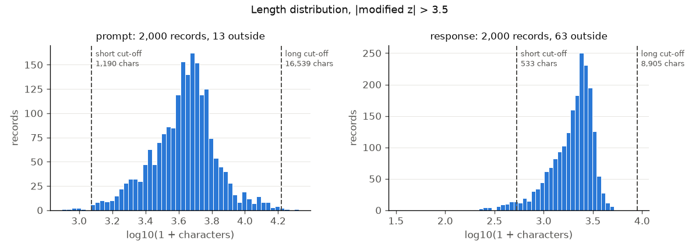

# sftlint

A linter for chat, SFT and tool-calling datasets in JSONL: it checks turn structure, truncation, tool calls against their declared schemas, refusals, language mix, duplicate prompts, length outliers and PII or secret patterns, writes a Markdown or JSON report with an exit code for CI, and can write a copy with only the flagged records or turns removed.

## Why this is hard

A fine-tuning file can parse as valid JSON on every line and still teach the wrong thing. A system turn in the middle of a conversation, two user turns in a row, or an empty assistant turn is accepted by most loaders and then rendered by a chat template into a token sequence the model never sees at inference time. A final answer cut off by a generation limit trains the model to stop mid-sentence. A credential pasted into a prompt is memorised. Tool-calling data adds its own failures: arguments that are not JSON, arguments that ignore the declared schema, results that answer a call nobody made. None of these are schema errors of the file, and they hide in files of hundreds of thousands of records written in five or six slightly different layouts (OpenAI `messages`, ShareGPT `from`/`value`, Alpaca `instruction`/`output`, prompt/completion pairs, text already rendered by a chat template, tool calls as JSON fields or as tags inside the text). Each check also has to be conservative: a rule that fires on a tenth of a clean dataset is switched off and never read again.

## Install

```
pip install git+https://github.com/vipul21435/sftlint
```

Python 3.10 or newer. No runtime dependencies outside the standard library. `pip install "sftlint[tiktoken] @ git+https://github.com/vipul21435/sftlint"` adds the optional tiktoken token counter.

## Quickstart

`examples/sample.jsonl` has thirteen small conversations, eleven of them with a planted problem.

```
$ sftlint check examples/sample.jsonl
examples/sample.jsonl: 13 records, format messages, 11 with findings (8 errors, 4 warnings, 2 info)
  duplicate-prompt   warning  1
  empty-turn         error    1
  final-role         warning  1
  language-mix       info     1
  refusal            info     1
  role-order         error    1
  system-position    error    1
  tool-args-json     error    1
  tool-args-schema   error    1
  tool-result-match  error    2
  tool-unknown       error    1
  truncated-final    warning  2
$ echo $?
1
```

The Markdown report adds length statistics, the refusal rate, and each finding with its line and turn:

```
$ sftlint check examples/sample.jsonl --fail-on never --markdown -
...
- line 3 turn 1: `truncated-final` unclosed code fence
- line 4 turn 1: `system-position` system turn is not the first turn
- line 5 turn 1: `role-order` two user turns in a row
- line 6 turn 1: `truncated-final` ends with ':'
- line 7 turn 1: `empty-turn` assistant turn content is empty
- line 8 turn 2: `final-role` last turn is user
- line 9: `duplicate-prompt` same prompt as line 2
- line 10 turn 1: `tool-args-schema` 'get_weather': $.unit: 'kelvin' is not one of ['celsius', 'fahrenheit']
- line 11 turn 1: `tool-args-json` 'get_forecast': arguments are not valid JSON: Expecting ',' delimiter at column 18
- line 11 turn 1: `tool-result-match` call 'get_forecast' gets no result
- line 11 turn 1: `tool-unknown` 'get_forecast' is not a declared tool
- line 11 turn 2: `tool-result-match` result id 'call_9' answers no pending call
- line 12 turn 1: `refusal` "I'm sorry, but"
- line 13 turn 1: `language-mix` user turn is Cyrillic, answer is Latin
```

Writing a fixed copy acts only on the rules named in `--fix-rules`:

```
$ sftlint check examples/sample.jsonl --fail-on never --fix fixed.jsonl --fix-rules final-role,empty-turn,duplicate-prompt
fix: 11 records written, 2 dropped, 1 trimmed, 1 dropped for duplicate-prompt, 1 dropped for empty-turn, 1 trimmed for final-role -> fixed.jsonl
```

Other commands and options:

```
sftlint rules                                  # every rule id, default severity, summary
sftlint detect data.jsonl                      # detected format and record counts
sftlint check data.jsonl --json report.json --markdown report.md
sftlint check data.jsonl --select role-order,empty-turn
sftlint check data.jsonl --ignore length-outlier --fail-on warning
sftlint check data.jsonl --format sharegpt --outlier-z 4 --max-examples 50
sftlint check data.jsonl --tokenizer tiktoken:cl100k_base   # needs the tiktoken extra
sftlint check data.jsonl --max-refusal-rate 0.02            # fail when over 2 % of answers refuse
```

Exit codes: 0 when no finding is at or above `--fail-on` (default `error`; `never` always exits 0), 1 when one is, 2 on a usage or I/O error. From Python, see `examples/lint_sample.py` (lint and print the Markdown report) and `examples/fix_sample.py` (lint, fix three rules, lint the copy again).

## How it works

**Formats.** Each record is normalised to a list of `(role, content, tool_calls, tool results)` turns plus the declared tools. `--format auto` (the default) takes a majority vote of per-record detection over the first 200 records; a record that does not match the file format is reported as `format-mismatch` instead of being guessed at. Supported layouts:

| format | shape | notes |
|---|---|---|
| `messages` | `{"messages": [{"role", "content"}, ...]}` (also under `conversation`, `conversations`, `chat`) | OpenAI chat format and the input of Hugging Face chat templates; `developer` maps to system, `function` to tool; list-of-parts content is joined; a top-level `tools` list is kept |
| `sharegpt` | `{"conversations": [{"from", "value"}, ...]}` | `human` to user, `gpt` to assistant; `function_call` turns become assistant tool calls and `observation` turns tool results, as in the LLaMA-Factory data format |
| `alpaca` | `{"instruction", "input", "output"}` | `instruction` and `input` are concatenated into the user turn, as LLaMA-Factory documents; sftlint separates them with a blank line |
| `prompt-completion` | `{"prompt", "completion"}` | one user and one assistant turn |
| `template-text` | `{"text": "<\|im_start\|>user\n...<\|im_end\|>..."}` | text already rendered by a chat template: ChatML, Zephyr (`<\|user\|> ... </s>`) or Llama 3 (`<\|start_header_id\|>role<\|end_header_id\|> ... <\|eot_id\|>`); the first two appear in the Hugging Face chat templating guide, the third in Meta's Llama 3 prompt-format page. A turn with no end-of-turn token is marked unterminated |

Tool calls are read from an OpenAI-style `tool_calls` list (arguments as a JSON string), from the dict form the Hugging Face tool-use guide recommends, from ShareGPT `function_call` turns, and from `<tool_call>{...}</tool_call>` blocks inside assistant text (the Hermes layout, which the same guide shows as model output). `<tool_response>` blocks in a tool turn are read as results with the function name they answer. Declared tools come from a top-level `tools` field (a list or a JSON string) or, failing that, from a `<tools>[...]</tools>` block in the system prompt.

**Rules.** Severities are defaults; `--fail-on` decides which ones fail a CI job.

| rule | severity | flags | why |
|---|---|---|---|
| `json-parse` | error | a line that is not valid JSON | nothing downstream can read it |
| `format-mismatch` | error | a record that does not match the file's format | mixed layouts are usually a merge mistake |
| `role-unknown` | error | a role outside system, user, assistant, tool | the OpenAI fine-tuning data-prep notebook rejects unrecognised roles; templates drop or crash on them |
| `system-position` | error | a system turn after the first turn | templates place the system prompt first; a later one is rendered in a position the model is not trained for |
| `role-order` | error | a first turn that is not user, two user or two assistant turns in a row, a user turn right after a tool result, a tool turn not preceded by an assistant tool call | the expected grammar is `user (assistant-with-tool-calls tool+)* assistant`, repeated |
| `empty-turn` | error | a turn with no text and no tool calls | trains on an empty target, or an empty context |
| `duplicate-turn` | warning | a turn that repeats an earlier turn of the same role verbatim (whitespace collapsed) | often a copy error in multi-turn synthesis |
| `final-role` | warning | a last turn that is not assistant | the record has no target to learn from; the OpenAI data-prep notebook checks that every conversation has an assistant message |
| `truncated-final` | warning | a final assistant turn with an unclosed triple-backtick fence, a last character that cannot end a sentence (`, ; : ( [ {` and operators), a last word that is an article, conjunction or preposition, or (rendered text) no end-of-turn token | the usual trace of a generation that hit its token limit |
| `refusal` | info | a final answer whose first 300 characters contain a refusal phrase at a sentence start | a refusal rate far from what the set intends skews a model towards over- or under-refusing; the report gives the rate |
| `refusal-rate` | error | the share of answers that open with a refusal phrase, when it is above `--max-refusal-rate` (off unless the flag is given) | a CI gate for the rate itself; one dataset-level finding, reported at line 0 |
| `language-mix` | info | a final answer whose dominant script differs from the last user turn's | a question answered in another language is usually a generation or translation fault |
| `duplicate-prompt` | warning | a record whose prompt (every turn before the final assistant turn, with roles, whitespace collapsed, case kept) equals an earlier record's | exact duplicates over-weight one prompt; near-duplicates are out of scope (see datasieve) |
| `length-outlier` | info | a prompt or response length that is a robust outlier for the file | catches empty-ish and runaway records without a fixed limit |
| `pii-email` | warning | an email address outside reserved domains and placeholder local parts | personal data in training text |
| `pii-card` | warning | 13 to 19 digits starting 2 to 6 that pass the Luhn checksum | payment card numbers |
| `secret-key` | error | a known credential prefix, a PEM private-key header, or a high-entropy value assigned to a key-like name | credentials in training text get memorised |
| `tool-args-json` | error | a tool call that cannot be read, or whose arguments are not a JSON object | the OpenAI function-calling guide defines arguments as JSON-encoded; a call that does not parse trains the model to emit calls a client cannot run |
| `tool-unknown` | error | a call to a function the record does not declare | the model learns to call tools it was never shown |
| `tool-args-schema` | error | arguments that fail the declared `parameters` JSON Schema (first three errors shown, with paths such as `$.unit`) | both the OpenAI and Hugging Face formats declare parameters as JSON Schema; arguments outside it teach wrong calls |
| `tool-result-match` | error | a tool result that answers no pending call, or a call that gets no result while the conversation goes on | results are matched to calls by id (the Hugging Face guide notes ids disambiguate several results), else by function name, else by position |

PII, secret and tool rules also read tool-call arguments, not only the text of each turn.

**Length outliers.** Scores use the modified z-score of Iglewicz and Hoaglin on `x = log(1 + chars)`:

```
M_i = 0.6745 (x_i - median(x)) / MAD,    MAD = median(|x_i - median(x)|)
```

A record is flagged when `|M_i| > 3.5` (the cut-off the NIST handbook quotes from Iglewicz and Hoaglin; change it with `--outlier-z`). The log makes the score symmetric for right-skewed lengths, and the median and MAD stop a few huge records from masking each other the way a mean and standard deviation would. The rule is skipped below 20 records. A test draws 20,000 standard normal values and checks that fewer than 0.2 % score above 3.5.

**PII and secrets.** Each pattern has a validation step:

- Email: domains reserved for documentation and testing by RFC 2606 and RFC 6761 (`example.com`, `.test`, `.invalid`, `localhost`) are skipped, as are local parts such as `your-email` or `recipient`.
- Card numbers: digits may be grouped by single spaces or hyphens; the first digit must be 2 to 6 (the card-network industry identifiers of ISO/IEC 7812, which also keeps ISBN-13 numbers out), the digits must not all be the same, and the Luhn checksum must hold: double every second digit from the right, subtract 9 from any result above 9, and require the total to be divisible by 10.
- Secrets: fixed prefixes (cloud access key ids, personal access tokens, chat-app bot tokens, PEM private-key headers) match directly. A value assigned to a name such as `api_key`, `token` or `password` must be at least 20 characters, mix at least two of lower case, upper case and digits, contain no placeholder word (`your`, `example`, `xxxx` ...), and have Shannon entropy `H = -sum p_c log2 p_c` of at least 3.5 bits per character.

Matches are masked in reports (first and last two characters kept), and each distinct match is reported once per conversation.

**Tool calls.** `tool-args-schema` uses a small JSON Schema validator in `sftlint/schema.py` with no dependency. It implements the keywords tool declarations use in practice: `type`, `enum`, `const`, `properties`, `required`, `additionalProperties`, `items`, `minItems`, `maxItems`, `minLength`, `maxLength`, `pattern`, `minimum`, `maximum`, `exclusiveMinimum`, `exclusiveMaximum`, `anyOf`, `oneOf`, `allOf` and `nullable`. As in the JSON Schema validation vocabulary, `integer` matches any number with a zero fractional part, and booleans are not numbers. Other keywords (`$ref`, `format`, conditionals) are ignored, so the validator can miss errors but does not invent them. A property test draws 2,000 random JSON values and checks that each validates against its own type, an `enum` that contains it, and an `anyOf` that includes its type.

`tool-result-match` walks each assistant turn with calls and the run of tool turns after it. Each result removes the pending call it answers. Calls still pending are reported only if the conversation continues past the call turn: in single-turn function-calling data the call itself is the training target and no result is expected.

**Refusals.** The phrase list starts from the refusal prefixes Zou et al. (2023) match in their attack-success check ("I'm sorry", "I apologize", "As an", "I cannot", "As a responsible AI", "it's not appropriate", ...) and narrows them so ordinary openings do not count: "As an" needs "AI" after it, "I cannot" needs a verb such as help, assist or provide, and "I'm sorry" needs ", but". The phrase must start the answer or a sentence within its first 300 characters.

**Language mix.** The standard library has no Unicode Script property (UAX #24), so the script of a letter is read from its character name (`CYRILLIC SMALL LETTER ZHE` is Cyrillic); CJK ideographs are Han, and a text whose letters are at least 10 % kana is labelled Japanese. Code in triple-backtick fences and inline backticks is removed first. A side needs at least 20 letters and one script with 60 % of them; otherwise it has no dominant script and the rule stays silent. The report also lists the dominant script of every answer.

**Tokens.** Length statistics are reported in characters, whitespace words and tokens. The default token counter, `pretokens`, counts the pieces of GPT-2's pre-tokenization pattern, rewritten for the `re` module. GPT-2's BPE never merges across those pieces, so for GPT-2 the count is a lower bound, up to the places where `re` classes differ from `\p{L}` and `\p{N}` (some combining marks and non-decimal numerals). `--tokenizer tiktoken:<encoding>` counts real BPE tokens with tiktoken. A tool call counts as its `{"name", "arguments"}` JSON, since those are tokens the model is trained on.

**Fix.** `--fix OUT --fix-rules a,b` writes a copy of the input. Records without a finding of a named rule are copied unchanged (blank lines are not copied). `final-role` and `empty-turn` trim: `final-role` cuts the turns after the last assistant turn, `empty-turn` cuts trailing empty turns. A trim that would leave a record not ending in a non-empty assistant turn, or a record with no turn list (Alpaca, prompt/completion, rendered text), drops the record instead. Every other rule drops the records it flags. The copy is not re-linted; run `sftlint check` on it again.

## Results on public data

Four files from three public datasets, all under the Apache 2.0 licence as stated on their dataset cards (checked on the pages linked below). The data is not committed; `scripts/fetch_data.py` downloads it (about 54 MB) into `./data`, which git ignores.

```
uv run python scripts/fetch_data.py --out data --rows 2000
uv run sftlint check data/smoltalk-magpie-ultra.jsonl --json data/smoltalk-magpie-ultra.report.json
uv run sftlint check data/hermes-func-calling-singleturn.jsonl --json data/hermes-func-calling-singleturn.report.json
uv run sftlint check data/hermes-func-calling.jsonl --json data/hermes-func-calling.report.json
uv run sftlint check data/aya-test.jsonl --json data/aya-test.report.json
```

| rule | smoltalk slice | Hermes single-turn | Hermes multi-turn | Aya test |
|---|---:|---:|---:|---:|
| records | 2,000 | 1,893 | 1,893 | 1,750 |
| records with findings | 78 | 995 | 1,050 | 51 |
| `tool-args-json` | 0 | 793 | 793 | 0 |
| `tool-args-schema` | 0 | 76 | 76 | 0 |
| `tool-result-match` | 0 | 0 | 263 | 0 |
| `role-order` | 0 | 0 | 10 | 0 |
| `final-role` | 0 | 0 | 163 | 0 |
| `truncated-final` | 5 | 0 | 0 | 4 |
| `duplicate-turn` | 3 | 0 | 0 | 0 |
| `duplicate-prompt` | 0 | 0 | 0 | 10 |
| `pii-email` | 0 | 62 | 82 | 0 |
| `pii-card` | 0 | 2 | 2 | 0 |
| `secret-key` | 0 | 0 | 3 | 0 |
| `length-outlier` | 76 | 125 | 167 | 34 |
| `refusal` | 0 | 0 | 0 | 1 |
| `language-mix` | 0 | 0 | 0 | 2 |
| every other rule | 0 | 0 | 0 | 0 |
| exit code | 0 | 1 | 1 | 0 |

**smoltalk, `smol-magpie-ultra` subset, first 2,000 train rows** ([dataset card](https://huggingface.co/datasets/HuggingFaceTB/smoltalk); the card states the Smol-Magpie-Ultra subset is Apache 2.0). Format detected: `messages`. All five `truncated-final` findings are unclosed code fences, and reading them shows each answer stops in the middle of code (for example a list literal ending in `4.7,`). The three `duplicate-turn` findings are repeated user turns such as "Would you continue with more ideas?". No answer opens with a refusal phrase, and all 2,000 answers are in Latin script. The median prompt (all turns before the last answer) is 4,436.5 characters and the median response 2,179.



The chart (`uv run --with matplotlib python scripts/plot_lengths.py data/smoltalk-magpie-ultra.jsonl docs/lengths-smoltalk.png`) bins `log10(1 + chars)` and marks where the modified z-score reaches 3.5: 13 prompts and 63 responses fall outside, the 76 `length-outlier` findings.

**hermes-function-calling-v1** ([dataset card](https://huggingface.co/datasets/NousResearch/hermes-function-calling-v1), Apache 2.0), two files: `func-calling-singleturn.json` (system, user, one assistant turn of `<tool_call>` blocks) and `func-calling.json` (the same requests with `<tool_response>` turns and a final answer). Format detected: `sharegpt`; tools read from the `tools` field.

The breakdowns in the first three bullets are printed by `uv run python scripts/explain_hermes.py data/hermes-func-calling-singleturn.jsonl` (and the same for `data/hermes-func-calling.jsonl`; both files give the same `tool-args-json` and `tool-args-schema` numbers). The script's docstring states the definitions it uses.

- `tool-args-json`, 793 records in each file: every one is a call whose body names `ExpertQAExtractor` and begins with a literal backslash-n (the two characters, not a newline). 787 of them also write at least one list item with a Python-style single quote (a `[` or `,` followed by `'`). Replacing the literal `\n` with a newline makes 6 of the 793 parse; the other 787 are exactly the ones with single-quoted items, and they are not JSON.
- `tool-args-schema`, 76 findings in 49 records, by the cause of each finding's first error: 56 pass a value where the declaration says `"enum": [null]` and 2 where it says `"enum": []`, so no real value can pass (the data's schema is wrong, not the call); 11 pass `null` where the schema declares a type (9 string, 1 boolean, 1 number); 7 omit a required property.
- `tool-result-match` (multi-turn only), 263 findings in 158 records: 258 are `<tool_response>` blocks for a function the assistant never called in that turn (for example the assistant calls `book_appointment` and the tool turn also returns `send_appointment_reminder`), and 5 are calls that get no response.
- `role-order`, 10: the records whose turns run system, human, tool, gpt, with a tool result before any call. `final-role`, 163: conversations that end on a tool turn, with no final answer.
- `secret-key`, 3: synthetic `access_token` values inside tool results; credential-shaped, made up by the generator.
- `pii-email` matches are addresses written into the synthetic requests and call arguments; the rule cannot tell a made-up address on a real domain from a real one, which is why it is a warning. In both files the 2 `pii-card` findings are the widely published test card number starting 4111, at lines 626 and 831. An earlier version of the card pattern also matched a 16-digit run inside a hex object id (`5fa9e56f` followed by 16 digits) in a multi-turn tool result; digit runs that touch a letter or underscore are now skipped.

`--fix` on the multi-turn file with the three structural tool rules:

```
$ uv run sftlint check data/hermes-func-calling.jsonl --fail-on never --fix data/hermes-func-calling.fixed.jsonl --fix-rules final-role,role-order,tool-result-match
fix: 1725 records written, 168 dropped, 5 trimmed, 158 dropped for final-role, 10 dropped for role-order, 158 dropped for tool-result-match, 5 trimmed for final-role -> data/hermes-func-calling.fixed.jsonl
$ uv run sftlint check data/hermes-func-calling.fixed.jsonl --select final-role,role-order,tool-result-match
data/hermes-func-calling.fixed.jsonl: 1725 records, format sharegpt, 0 with findings (0 errors, 0 warnings, 0 info)
```

The 158 records that end on a tool turn are the same records whose tool turn answers calls that were not made, so they are dropped; the 5 others ending on a tool turn are trimmed back to their call turn.

**aya_dataset, test split, all 1,750 rows** ([dataset card](https://huggingface.co/datasets/CohereLabs/aya_dataset), Apache 2.0): human-written prompt/completion pairs, 250 in each of seven languages. Format detected: `prompt-completion`. The 10 `duplicate-prompt` findings are prompts written twice: 5 with the same answer both times, 5 with a different one. Of the 4 `truncated-final` findings, two Turkish answers end on a list separator after a heading or item, and one English answer ends "The following would be the cross:" with no cross after it; the fourth, a Portuguese list whose last item ends in `;`, is a false positive. The one `refusal` is "I won't answer that question." to a request for bomb-making instructions.

Because every record carries a language label, the run also shows what the script detector does per language:

```
uv run python scripts/script_by_language.py data/aya-test.jsonl
```

| language | records | dominant script of answers | language-mix |
|---|---:|---|---:|
| English | 250 | Latin 215, none 34, Devanagari 1 | 0 |
| Portuguese | 250 | Latin 196, none 54 | 0 |
| Simplified Chinese | 250 | Han 191, none 58, Latin 1 | 0 |
| Standard Arabic | 250 | Arabic 210, none 40 | 0 |
| Telugu | 250 | Telugu 194, none 55, Latin 1 | 1 |
| Turkish | 250 | Latin 247, none 2, Arabic 1 | 1 |
| Yoruba | 250 | Latin 243, none 7 | 0 |

"none" is an answer with fewer than 20 letters or no script holding 60 % of them, mostly short answers. `language-mix` flags 2 of 1,750 records: a Telugu question whose answer is mostly Latin-letter algebra (`px + q = 0 ⇒ ...`), a false positive, and a Turkish question asking what an Ottoman word means, answered with a dictionary entry in Arabic script, which is a real change of script that the question asked for. Neither is an answer in the wrong language. The answers here are human-written in the prompt's language, so this split mostly measures false positives: 2 in 1,750.

An earlier version of `truncated-final` also flagged a Telugu answer key ending `iv-a` (the last word `a`) and a Telugu verse ending in `||`; both were fixed in the rule after this run showed them, so the 4 above are counted after the fix.

**Pretokens against a real tokenizer.** On the smoltalk slice, `--tokenizer tiktoken:cl100k_base` (`uv run --with tiktoken sftlint check data/smoltalk-magpie-ultra.jsonl --tokenizer tiktoken:cl100k_base --json data/smoltalk-magpie-ultra.cl100k.json`) gives a mean of 984.9 prompt tokens and 436.8 response tokens, against 989.2 and 438.4 pretokens: the means differ by 0.4 %. The maxima differ more (4,341 against 4,533 prompt tokens), so treat pretokens as an estimate for cl100k_base, not a bound.

**Time.** With JSON and Markdown reports written, three runs of `/usr/bin/time -p uv run sftlint check data/<file>.jsonl --json ... --markdown ...` took 4.28 to 4.44 s of wall time for the smoltalk slice (14 MB), 3.46 to 3.82 s for the single-turn Hermes file (17 MB) and 4.24 to 4.65 s for the multi-turn one (20 MB), on an arm64 laptop, including `uv run` start-up.

## Limitations

Not implemented:

- Inputs other than JSONL (no Parquet, no JSON arrays), and chat layouts other than the five above. Rendered template text is read for ChatML, Zephyr and Llama 3 only; Mistral and Llama 2 `[INST]` text is not parsed. The `template-text` reader is tested on fixtures only: no public rendered-text dataset with a licence stated on its card was run here.
- Tool declarations in formats other than `{"type": "function", "function": {...}}` and flat `{"name", "parameters"}`. JSON Schema `$ref`, `format`, `patternProperties` and conditionals are ignored by `tool-args-schema`.
- Tool results are not checked against any declared return schema, and the content of a result is not read beyond its id and function name.
- Language identification. `language-mix` compares scripts, so English answered in French, or Hindi answered in Marathi, is not caught; a translation task whose answer is meant to be in another script is flagged.
- A refusal classifier. `refusal` is a phrase match: a refusal worded differently is missed, and a quoted refusal inside a longer answer near the start is counted.
- `--fix` acts on whole records or trailing turns only; it never edits text inside a turn, never repairs tool-call JSON, and does not re-lint its output. The dataset-level `refusal-rate` finding names no record, so `--fix` does nothing for it.
- Near-duplicate detection and schema quarantine: see datasieve.

Known behaviour:

- `truncated-final` is a heuristic. A final Markdown table row (a last line that starts and ends with `|`), a last word ending in `++` and a final URL ending in `/` are treated as complete. Still flagged: an answer that legitimately ends with a colon, a semicolon-terminated list item, a formula ending in an operator, a pipe that does not close a table row, and a code answer that closes its fence with four backticks. An answer cut at a sentence boundary is not caught. Rerunning the four files above after the table, `++` and URL exceptions were added gave the same counts.
- `duplicate-prompt` is exact. Prompts that differ by one character are not duplicates here.
- `length-outlier` is relative to the file: in a file that is mostly broken, the broken records are the norm.
- `pii-*` and `secret-key` are pattern matches with validation, not a PII classifier. Names, phone numbers and postal addresses are not detected.
- `pretokens` is close to a lower bound only for GPT-2's tokenizer; for others it is an approximation (measured above for cl100k_base).

## Related tools

- [datasieve](https://github.com/vipul21435/datasieve): validate and deduplicate SFT and preference data (schema quarantine, exact and MinHash near-dedup, contamination checks). sftlint reports exact duplicate prompts but does not quarantine records, and leaves near-dedup to datasieve.
- [prefpairs](https://github.com/vipul21435/prefpairs): store pairwise preference judgments and rank with Bradley-Terry and Elo.
- [taskledger](https://github.com/vipul21435/taskledger): schema validation and lint rules for benchmark-task bundles.
- [trajlens](https://github.com/vipul21435/trajlens): read coding-agent trajectories, measure per-run behaviour and classify failures.

## References

- OpenAI Cookbook, "Data preparation and analysis for chat model fine-tuning": https://github.com/openai/openai-cookbook/blob/main/examples/Chat_finetuning_data_prep.ipynb
- OpenAI API docs, function calling guide (parameters as JSON Schema, JSON-encoded arguments, call ids): https://developers.openai.com/api/docs/guides/function-calling
- Hugging Face Transformers, chat templating guide: https://huggingface.co/docs/transformers/main/en/chat_templating
- Hugging Face Transformers, tool use guide (`tool_calls` as dicts, `<tool_call>` output, tool call ids): https://huggingface.co/docs/transformers/main/en/chat_extras
- Meta, Llama 3 model card and prompt formats: https://dev.meta.ai/llama/docs/model-cards-and-prompt-formats/meta-llama-3/
- LLaMA-Factory data format (Alpaca and ShareGPT, `function_call` and `observation` tags): https://github.com/hiyouga/LLaMA-Factory/blob/main/data/README.md
- JSON Schema Validation: A Vocabulary for Structural Validation of JSON (draft 2020-12): https://json-schema.org/draft/2020-12/json-schema-validation
- A. Zou, Z. Wang, N. Carlini, M. Nasr, J. Z. Kolter, M. Fredrikson, "Universal and Transferable Adversarial Attacks on Aligned Language Models", 2023: https://arxiv.org/abs/2307.15043 (refusal prefix list in the authors' demo notebook: https://github.com/llm-attacks/llm-attacks/blob/main/demo.ipynb)
- Unicode Standard Annex #24, Unicode Script Property: https://www.unicode.org/reports/tr24/
- NIST/SEMATECH e-Handbook of Statistical Methods, 1.3.5.17 Detection of Outliers (modified z-score): https://www.itl.nist.gov/div898/handbook/eda/section3/eda35h.htm
- Luhn algorithm: https://en.wikipedia.org/wiki/Luhn_algorithm
- ISO/IEC 7812 (issuer identification numbers): https://en.wikipedia.org/wiki/ISO/IEC_7812
- RFC 2606, Reserved Top Level DNS Names: https://www.rfc-editor.org/rfc/rfc2606
- RFC 6761, Special-Use Domain Names: https://www.rfc-editor.org/rfc/rfc6761

## Licence

MIT. See [LICENSE](LICENSE).

Built by Vipul Raj Jha · https://vipul21435.github.io
